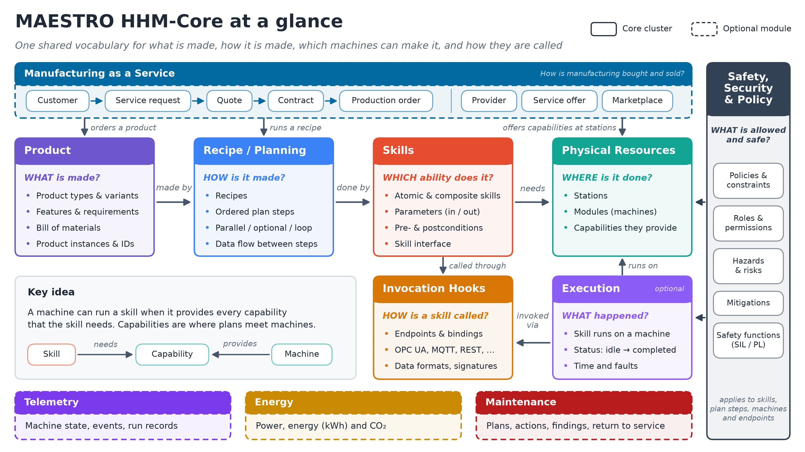

# MAESTRO HHM-Core: student package

**A modular OWL 2 RL ontology for skill-based, reconfigurable manufacturing.**
It follows the HHM-Core v1 reference model and takes its definitions from MAESTRO 1.0.

`https://w3id.org/maestro/hhm` · prefix `maestro:` · 27 Turtle modules · 117 classes · 205 properties



This folder holds everything you need to use the ontology in your project: the
ontology itself, the SHACL shapes that check your data, two worked examples,
ready-made SPARQL queries, documentation, and a starter template.

| | |
|---|---|
| Ontology IRI | `https://w3id.org/maestro/hhm` |
| Namespace | `maestro:` = `https://w3id.org/maestro#` |
| Version | 0.1.0 |
| Profile | OWL 2 RL, plus SHACL shapes (prefix `mhsh:`) |
| Author | Melwin Xavier |

## What the ontology describes

MAESTRO HHM-Core describes production systems with one vocabulary from design time
to runtime:

| Cluster | Answers | Main classes |
|---|---|---|
| Physical resources | *Where* is it done? | `Station`, `Module`, `Capability` |
| Skills | *Which ability* does it? | `AtomicSkill`, `CompositeSkill`, `ParameterDef`, `Precondition`, `Postcondition` |
| Recipe / planning | *How* is it made? | `Recipe`, `PlanStep`, `ControlFlowConstraint`, `DataBinding` |
| Product | *What* is made? | `ProductType`, `Variant`, `Feature`, `BOMNode`, `Material` |
| Invocation hooks | *How* is a skill called? | `SkillInterface`, `Endpoint`, `Protocol`, `Binding` |
| Safety, security and policy | *What* is allowed and safe? | `Policy`, `Role`, `Hazard`, `Risk`, `Mitigation`, `SafetyFunction` |
| Execution | *What* happened? | `SkillExecution`, `ExecutionStatus`, `Fault` |

Optional modules add **telemetry** (machine state, events), **energy** (power and
kWh measurements), **maintenance** (plans, actions, findings) and **manufacturing as
a service** (offers, quotes, contracts, orders). The `ext/` modules connect to OPC UA,
MQTT, REST, DDS, Modbus, PROFINET, EtherCAT, ISA-88, ISA-95, AutomationML, DTDL,
PROV-O and ODRL.

**Key idea:** a machine can run a skill when it provides every capability the skill
needs. Capabilities are where plans meet machines:
`Skill —requiresCapability→ Capability ←providesCapability— Module`.

## Quick start

### 1. Look at the ontology

- **Protégé:** open `maestro-hhm-core.ttl`. The `catalog-v001.xml` next to it makes
  Protégé load all 27 modules from this folder, so you don't need internet access.
- **One file:** `dist/maestro-hhm-core-full.ttl` is the whole ontology merged into a
  single file. It is also available as RDF/XML (`.owl`) and JSON-LD (`.jsonld`). Use
  it with tools that cannot read catalogs.
- **In the browser:** open `docs/graph.html` for an interactive graph of all classes and
  properties.
- **Term dictionary:** [`docs/terms.md`](docs/terms.md) lists every class and property
  with its definition.

### 2. Study an example

| Example | What it shows |
|---|---|
| [`examples/widget-cell/`](examples/widget-cell/) | A small reference cell that uses **every** cluster: a station with a module, a composite skill, a three-step recipe, a product with its BOM, a safety policy, OPC UA / REST / DTDL / AutomationML bindings, an ISA-95 hierarchy, a maintenance plan and a digital twin. `plant.ttl` is design time, `market.ttl` manufacturing as a service, `runtime.ttl` a runtime snapshot. **Start here.** |
| [`examples/ltu-festo-mps/`](examples/ltu-festo-mps/) | A real four-station Festo MPS line (Distributing → Testing → Processing → Handling) built from the Festo manuals: I/O signals, bills of materials, GRAFCET sequences as recipes, safety and maintenance. See its README. |

### 3. Build your own knowledge graph

1. Copy [`template/my-plant.ttl`](template/my-plant.ttl) and change the `my:` namespace
   to your own.
2. Describe your system with `maestro:` classes and properties only. Don't declare new
   classes; if you need one, ask first.
3. Check it:

```bash
pip install rdflib pyshacl
python tools/check.py template/my-plant.ttl
```

`tools/check.py` loads the ontology together with your data and checks it against the
SHACL shapes. A **Violation** is an error you must fix (for example a plan step with no
skill). A **Warning** is a recommendation (for example a product with no identifier).

### 4. Ask questions with SPARQL

```bash
python tools/check.py my-plant.ttl --query queries/cq/cq01-station-modules-capabilities.rq
```

[`queries/README.md`](queries/README.md) lists the 15 competency questions
(`queries/cq/`) and the 4 LTU questions (`queries/ltu/`). From Python:

```python
from rdflib import Graph

g = Graph()
g.parse("dist/maestro-hhm-core-full.ttl")
g.parse("examples/widget-cell/plant.ttl")

q = open("queries/cq/cq01-station-modules-capabilities.rq").read()
for row in g.query(q):
    print(row.station, row.module, row.capabilityLabel)
```

## Folder layout

```
maestro-hhm-core.ttl     Umbrella ontology (imports the 27 modules)
catalog-v001.xml         Lets Protégé load the modules from this folder
core/                    The seven HHM-Core v1 clusters
modules/                 telemetry, energy, maintenance, maas
ext/                     Standard and protocol extensions (OPC UA, MQTT, ISA-95, ...)
shapes/                  SHACL shapes that check your data
dist/                    The whole ontology in one file: .ttl, .owl, .jsonld
examples/                widget-cell and ltu-festo-mps knowledge graphs
queries/                 SPARQL competency questions
template/                Starter file for your own knowledge graph
tools/check.py           SHACL check and query runner
docs/                    Guides, term dictionary, interactive graph
figures/                 Architecture figures
alignment/               Mappings to MAESTRO 1.0 and HHM-Core
```

## Documentation

| Document | Content |
|---|---|
| [`docs/01-overview.md`](docs/01-overview.md) | Purpose, how clusters map to modules, design boundary, import graph |
| [`docs/02-conventions.md`](docs/02-conventions.md) | Naming, term templates and OWL 2 RL rules |
| [`docs/03-standards-basis.md`](docs/03-standards-basis.md) | The external standards and vocabularies referenced |
| [`docs/04-competency-questions.md`](docs/04-competency-questions.md) | The competency questions and how to write one |
| [`docs/terms.md`](docs/terms.md) | Term dictionary, one table per module |
| [`docs/hhm-conformance.md`](docs/hhm-conformance.md) | Each HHM-Core v1 class and relation and its `maestro:` term |
| [`docs/placement.md`](docs/placement.md) | Where each MAESTRO 1.0 module went, and why |
| [`docs/graph.html`](docs/graph.html) | Interactive class and property graph (open in a browser) |
| [`figures/README.md`](figures/README.md) | The figures in this package |

The docs sometimes mention `tools/validate.py`, `tools/build.py` and numbered
"gates". Those are the maintainer's build tools and are not part of this package;
use `tools/check.py` instead.

## Tips

- Write every term with its prefix (`maestro:Station`). Many names also exist in
  MAESTRO 1.0, so a bare name is ambiguous.
- Keep design-time data (stations, skills, recipes, products) and runtime data
  (executions, states, measurements) in separate files, as the widget cell does.
- Units go in `maestro:unitRef` as a QUDT unit IRI, e.g.
  `<http://qudt.org/vocab/unit/MilliM>`.

## License

Released under the MIT License. © Melwin Xavier.
