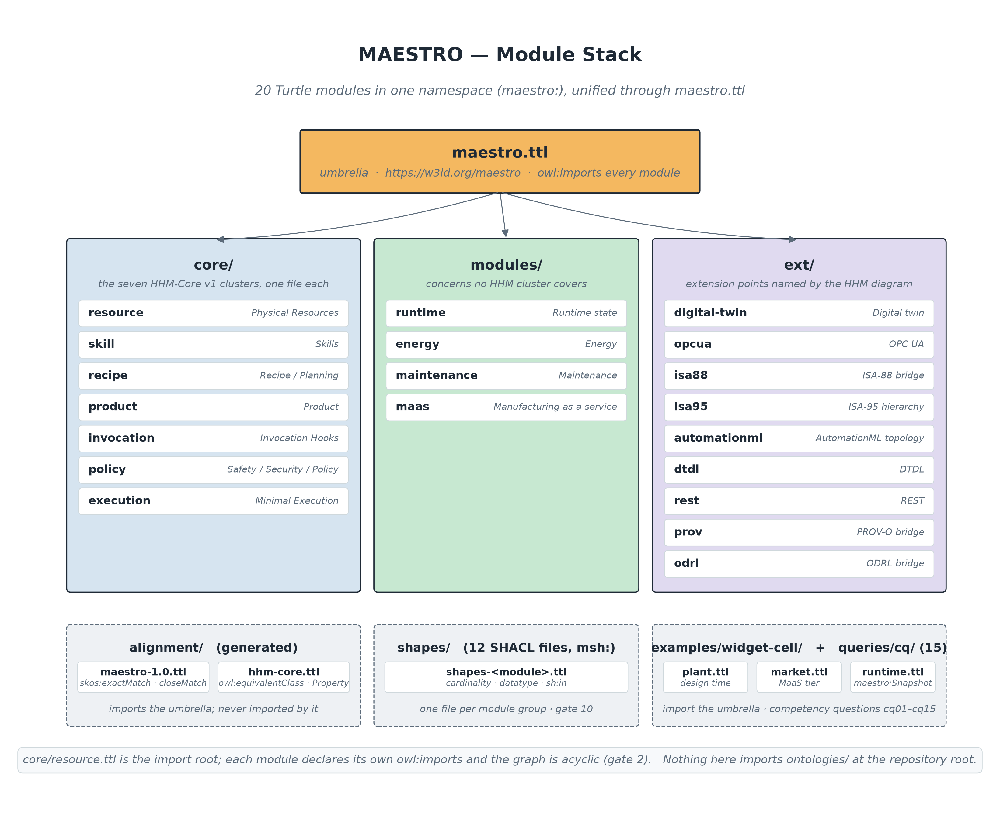
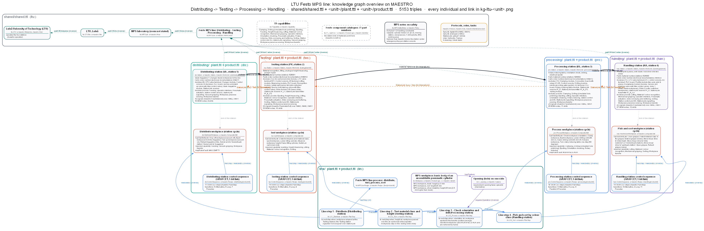

<div align="center">

# MAESTRO

**A modular OWL 2 RL ontology for skill-based, reconfigurable manufacturing.**
It follows the HHM-Core v1 reference model and takes its definitions from MAESTRO 1.0.

[](CHANGELOG.md)
[](docs/02-conventions.md)
[](shacl/)
[](#license)

`https://w3id.org/maestro` · prefix `maestro:` · 20 Turtle modules · 126 classes · 207 properties


</div>

---

## Contents

- [Overview](#overview)
- [Quick start](#quick-start)
- [Architecture](#architecture)
- [Example knowledge graph](#example-knowledge-graph)
- [Queries](#queries)
- [Repository layout](#repository-layout)
- [Tooling](#tooling)
- [Standards and alignment](#standards-and-alignment)
- [Scope](#scope)
- [Documentation](#documentation)
- [License](#license)

## Overview

MAESTRO describes production systems with one vocabulary from design time
to runtime. It covers the stations and modules on the shop floor, the skills they
offer, the recipes that use those skills, the products they make, how each skill is
invoked, and the policies, executions and digital twins around them.

- **Follows the HHM-Core v1 schema.** Each of the seven HHM clusters is one file,
  and class and relation names come from the HHM diagram; nine of them carry a clearer
  name since 0.2.0 and are mapped back to their HHM names in the generated
  `alignment/hhm-core.ttl` (see [Standards and alignment](#standards-and-alignment)).
- **Definitions come from MAESTRO 1.0.** Each term records where its definition came
  from: `dct:source` when it was reused as is, `dct:references` when it was adapted.
- **Everything is in one namespace.** All terms use `maestro:`, the profile is OWL 2 RL,
  and SHACL shapes check cardinalities and datatypes.
- **The example is a real plant.** The repository includes the knowledge graph of a
  four-station Festo MPS line.

| | |
|---|---|
| Ontology IRI | `https://w3id.org/maestro` |
| Namespace | `maestro:` = `https://w3id.org/maestro#` |
| Version | 0.2.0 (`owl:versionIRI https://w3id.org/maestro/0.2.0`) |
| Profile | OWL 2 RL, plus SHACL shapes (prefix `msh:`) |
| Size | 126 classes, 144 object properties, 63 datatype properties, 69 named individuals (plus 13 deprecated 0.1.0 names kept as equivalents) |
| Author | Melwin Xavier |

## Quick start

**In Protégé or any tool that reads catalogs:** open `maestro.ttl`. The
committed `catalog-v001.xml` resolves all twenty `owl:imports` to the local files.

**Without catalog support:** load the single-file ontology
[`maestro-merged.ttl`](maestro-merged.ttl).
No build is needed. `python tools/build.py` also writes RDF/XML and JSON-LD copies to a
local `dist/` folder (not committed).

**From Python:**

```python
from rdflib import Graph

g = Graph()
g.parse("maestro-merged.ttl")
g.parse("usecase-knowledge-graphs/ltu-festo-mps/shared/shared-merged.ttl")
g.parse("usecase-knowledge-graphs/ltu-festo-mps/distributing/distributing-merged.ttl")

q = open("queries/cq/cq01-station-modules-capabilities.rq").read()
for row in g.query(q):
    print(row.station, row.module, row.capabilityLabel)
```

## Architecture

The umbrella ontology imports twenty modules in two layers. The imports form an
acyclic graph rooted at `core/resource.ttl`. The root module also declares the kind of
every external term the package uses (Dublin Core, VANN, SKOS and schema.org annotation
properties, and the PROV-O and ODRL terms of the two bridge modules), so the ontology
and each module's import closure pass OWL 2 RL and OWL 2 DL profile validation without
importing any upstream ontology.

<p align="center">
  
</p>

| Layer | Modules | Covers |
|---|---|---|
| **`core/`** (HHM clusters, plus the market tier) | `resource`, `skill`, `recipe`, `product`, `invocation`, `policy`, `execution`, `maas` | Stations, modules and capabilities; atomic and composite skills with parameters and conditions; recipes, plan steps and data bindings; products, variants, BOMs and materials; endpoints, protocols and bindings; policies, hazards, risks and safety functions; skill executions and faults; manufacturing as a service (offers, quotes, contracts, orders), which is not an HHM cluster |
| **`experimental-extensions/`** (MAESTRO additions and extension points) | `runtime`, `energy`, `maintenance`; `digital-twin`, `opcua`, `isa88`, `isa95`, `automationml`, `dtdl`, `rest`, `prov`, `odrl` | Concerns that MAESTRO has and the HHM diagram does not (state model and snapshots, energy and power measurements, maintenance actions and plans), and connections to the standards that the HHM diagram names as extension points |

[`docs/graph.html`](docs/graph.html) is an interactive graph of the classes and
properties; open it in a browser.

## Example knowledge graph

The example uses `maestro:` terms only. Each unit of the use case is split like the ontology
itself: one Turtle file per MAESTRO module under `core/` and `ext/`, an umbrella file that
imports them, and a generated `<name>-merged.ttl` with everything in one document
([layout and loading](usecase-knowledge-graphs/README.md)).

### LTU Festo MPS — [`usecase-knowledge-graphs/ltu-festo-mps/`](usecase-knowledge-graphs/ltu-festo-mps/)

A four-station Festo Didactic Modular Production System line (Distributing → Testing →
Processing → Handling). It is built from the station manuals, circuit diagrams, parts
lists and GRAFCET charts. Every I/O signal has its SysLink bit, pin and equipment
identifier, every GRAFCET action is a skill, and each station's GRAFCET is a recipe
with its control flow.

<p align="center">
  
</p>

## Queries

Each question is a standalone SPARQL file. The validator runs the competency questions
over a small synthetic fixture ([`queries/fixtures/`](queries/fixtures/)), where each must
be answered in full, and reports how far the use-case graphs answer them today; the
LTU questions must return a minimum number of rows over the use-case
graphs ([details](queries/README.md)).

| Set | Files | Asks about |
|---|---|---|
| Competency questions | [`queries/cq/`](queries/cq/) `cq01`–`cq15` | Station structure, skills, recipes, BOMs, policies, hazards, invocation paths, execution traces, faults, state, energy, maintenance, quotes and contracts |
| LTU questions | [`queries/ltu/`](queries/ltu/) `lq01`–`lq04` | I/O allocation, line route by capability, GRAFCET sequences, station BOMs |

```sparql
PREFIX maestro:   <https://w3id.org/maestro#>
PREFIX rdfs: <http://www.w3.org/2000/01/rdf-schema#>

# CQ01 - Which stations have which modules, and which capabilities does each module provide?
SELECT ?station ?module ?capability ?capabilityLabel
WHERE {
    ?station a maestro:Station ;
             maestro:hasModule ?module .
    OPTIONAL {
        ?module maestro:providesCapability ?capability .
        OPTIONAL { ?capability rdfs:label ?capabilityLabel }
    }
}
ORDER BY ?station ?module ?capability
```

## Repository layout

```
maestro.ttl              Umbrella ontology (imports the 20 modules)
maestro-merged.ttl       Generated: all modules in one file (do not edit)
catalog-v001.xml         OASIS catalog with relative paths, for Protégé
core/                    The seven HHM-Core v1 clusters, plus maas
experimental-extensions/ runtime, energy, maintenance, digital-twin, opcua, isa88, isa95, automationml, dtdl, rest, prov, odrl
shacl/                   SHACL shapes, one file per module group; probes/ tests the shapes
usecase-knowledge-graphs/ ltu-festo-mps
queries/                 cq/, ltu/ SPARQL files; fixtures/ synthetic test data for cq/
docs/                    Hand-written guides and generated reference pages
figures/v0.2.0/          Architecture and knowledge-graph figures with their renderers
tools/                   Validation, build and generation scripts
```

## Tooling

The scripts need Python with `rdflib`, `pyshacl` and `owlrl`
([pinned versions](tools/requirements.txt)) and run on this package
alone. The figure renderer also needs `matplotlib` and Graphviz `dot`.

```bash
python tools/validate.py              # all 12 validation gates, exit 1 on any failure
python tools/validate.py --schema     # gates 1-7 only (modules, no examples)
python tools/build.py                 # regenerate maestro-merged.ttl, catalog-v001.xml and docs/terms.md (+ local dist/)
python tools/build.py --check         # report stale generated files, write nothing
python tools/gen_alignment.py --write # regenerate docs/hhm-conformance.md (and alignment/, see below)
python tools/gen_graph.py             # regenerate docs/graph.html
python tools/merge_usecases.py        # rewrite the <name>-merged.ttl of every use case (--check verifies)
python figures/v0.2.0/scripts/render_v020.py   # all figures
```

> [!NOTE]
> Two checks read material that is not part of this package, and say so in their output
> when it is absent: gate 7 looks up each mapping target in the pinned copy of its
> vocabulary (`references/`) and each `dct:source` target in the MAESTRO 1.0 sources
> (`ontologies/`). Both folders are looked up next to the package folder, where they sit
> when the package is checked out inside the MAESTRO 1.0 repository. Without them gate 7
> still checks that every target is in a vocabulary of the standards basis.

<details>
<summary><b>The twelve validation gates</b></summary>

1. Every `.ttl` and `.rq` file parses.
2. Imports resolve inside the package, with no cycles.
3. Every declared term is in `maestro:`, and its `rdfs:isDefinedBy` is its module IRI;
   external terms are declared, and nothing more, in `core/resource.ttl`.
4. No local name is declared in two files.
5. The OWL 2 RL lint (`tools/rl_lint.py`) passes: every class and property used is
   declared, classes are named, datatypes are in the RL datatype map, and every term has
   a label and a definition.
6. The `owlrl` closure has no conflicts, and no literal is outside the declared range of
   its datatype property (an inconsistency the RL rules do not report).
7. Mapping targets are in the standards basis (and in its pinned references where
   available), and hook names appear without IRIs.
8. Every `maestro:` term used in the examples, fixtures and queries is declared.
9. Design-time example files hold no runtime instances.
10. The shapes find no violation in the modules plus the examples, and every probe in
    `shacl/probes/` gives its expected result.
11. Every competency question is answered in full over the synthetic fixture, and every
    LTU question returns at least its minimum number of rows over the
    use-case graphs. How far the use-case graphs answer the competency questions
    (answered, partial, no data) is reported and does not fail the gate.
12. Generated files are up to date, including the merged copy of every use case.

`build.py` stops if a module's `owl:versionInfo`, `owl:versionIRI` or `dct:isPartOf`
differs from the umbrella's. The only way to change the version is
`build.py --set-version`.

</details>

## Standards and alignment

**Mapping rule.** A term may be mapped to an external term only if that term exists in
a pinned copy of the vocabulary. This applies to documentary mappings (`skos:*Match`)
and logical ones (`rdfs:subClassOf`, `rdfs:subPropertyOf`). Gate 7 enforces it. The
vocabularies referenced at 0.1.0 are PackML, WADL, DIN EN 61360, VDI 2206, ISA-88.01,
DIN EN 62264-2, OPC UA, AutomationML, ISO 22400-2 (HSU-AUT ontology design patterns),
schema.org, DTDL v3, PROV-O and the ODRL 2.2 core profile. See
[`docs/03-standards-basis.md`](docs/03-standards-basis.md).

**Hooks only.** The HHM diagram also names ECLASS, DPP, PRONTO, CaSkMan / CSS, AAS,
OpenAPI, SAREF4INMA and XACML. These appear in module comments as hooks, with no IRIs,
no mappings and no conformance claim.

**Relation to MAESTRO 1.0.** Two alignment files can be generated from the per-term
provenance annotations. They are optional outputs and are not shipped in this
repository: `tools/gen_alignment.py --write` writes them only when the MAESTRO 1.0
sources are available to verify every target (see the note under [Tooling](#tooling)).

- `alignment/maestro-1.0.ttl` maps terms to MAESTRO 1.0
  with `skos:exactMatch` / `skos:closeMatch`.
- `alignment/hhm-core.ttl` maps terms to the
  `https://w3id.org/hhm-core#` placeholder namespace with `owl:equivalentClass` /
  `owl:equivalentProperty`.

Both files import the umbrella, and the umbrella imports neither. Many local names are
the same in both ontologies (`Station`, `Skill`, `Recipe`, ...), so if you load MAESTRO
1.0 data and data written against this package into one store, write queries with explicit
prefixes. Since 0.2.0 this package uses the ontology IRI `https://w3id.org/maestro`, which
was the MAESTRO 1.0 umbrella IRI, and most of its module IRIs; it replaces MAESTRO 1.0 under
those identifiers, so never import both ontology stacks together (see
[docs/02-conventions.md](docs/02-conventions.md)).

## Scope

These were left out on purpose:

- **Unit module.** `maestro:unitRef` holds a QUDT unit IRI as an `xsd:anyURI`. Measured
  quantities put the unit in the property name (`maestro:energyKwh`, `maestro:powerWatts`,
  `maestro:mtbfHours`, ...).
- **Sensor module.** SOSA/SSN observations are a documented hook on `maestro:Skill`.
- **Other areas.** There is no process taxonomy, capability reasoning chain, PLC /
  IEC 61499 / ROS adapters, quality, LCA, security, discovery, or planning beyond
  production orders. [`docs/01-overview.md`](docs/01-overview.md) explains these
  boundaries.

## Documentation

| Document | Content |
|---|---|
| [`docs/01-overview.md`](docs/01-overview.md) | Purpose, how clusters map to modules, design boundary, import graph |
| [`docs/02-conventions.md`](docs/02-conventions.md) | Header and term templates, naming and OWL 2 RL rules |
| [`docs/03-standards-basis.md`](docs/03-standards-basis.md) | Every external vocabulary referenced, and the hooks |
| [`docs/04-competency-questions.md`](docs/04-competency-questions.md) | The fifteen competency questions, how they are tested and how to add one |
| [`docs/placement.md`](docs/placement.md) | Where each MAESTRO module went, and why |
| [`docs/terms.md`](docs/terms.md) | Generated term dictionary, one table per module |
| [`docs/hhm-conformance.md`](docs/hhm-conformance.md) | Generated table mapping each HHM-Core v1 class and relation to its package term |
| [`figures/README.md`](figures/README.md) | The figures and how to re-render them |
| [`CHANGELOG.md`](CHANGELOG.md) | Release history |

## License

Released under the MIT License. © Melwin Xavier.
